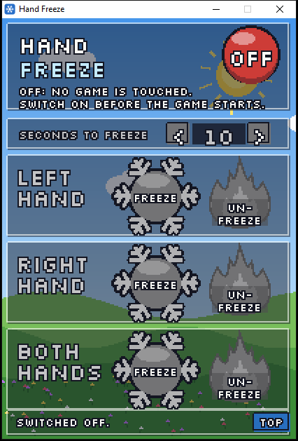
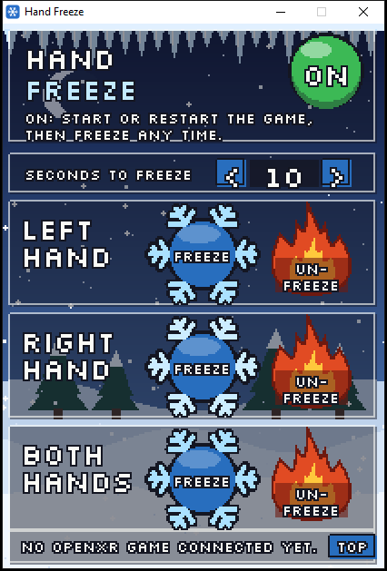

# Hand Freeze — hold both VR controllers still, in any OpenXR game

 

A small desktop app that freezes your VR hands in place, so you can set the controllers down and fine-tune
hand and weapon poses. It has a round switch (red OFF, fading to green ON), a seconds picker, and three rows,
**LEFT HAND**, **RIGHT HAND** and **BOTH HANDS**, each with a snowflake **FREEZE** button and a flame **UN-FREEZE** button.
Press FREEZE, hold the controllers where you want the in-game hands, and when the countdown runs out (it
shows in the snowflake, with a beep each second and a long beep at the end) those hands stay exactly
there, fixed in the room, while the game keeps running and the headset keeps tracking. Put the
controllers down, lean in, look at the hands from any side, move sliders with the mouse. UNFREEZE lets
them follow again. Closing the window always unfreezes. A summer scene plays behind it while it is off,
a frozen winter while it is on.

Made for tuning hand and finger poses in our VR mods (2026-10-13), where holding two controllers in
one hand while dragging sliders on the monitor was the only way before.

## Get it

Download the zip from [Releases](https://github.com/TefMeister/hand-freeze-vr/releases), unzip it, right-click
`install.ps1` and choose **Run with PowerShell**. A **Hand Freeze** icon appears on the desktop; no administrator
rights are needed. With the [Lanes plugin](https://github.com/TefMeister/lanes-plugin), `/lanes:setup` installs it
for you and `/lanes:update` says when a newer one is out.

## Use

1. Double-click **Hand Freeze** on the desktop and press the round switch: **ON**. Leave it on.
2. Start the game. The switch must be on **before** the game starts (OpenXR add-ons load at start); a
   game that was already running needs one restart. The window itself can be opened and closed any time.
3. The bottom line says *Connected: <game>.exe (LR)* once the game asks for a controller pose; L and R
   show which hands it has told apart.
4. Pick the seconds, press a row's snowflake, hold still. The flame lets that row's hands go. **ALWAYS ON TOP**
   keeps the window above the game.
5. **BUTTONS TOO** (the tick box under the title, v3): a freeze then also holds what the fingers are doing on
   those controllers: a trigger pulled (or half-pulled), a grip squeezed, a stick pushed, a button held. Tick it,
   press a snowflake, hold the buttons the way the pose needs them until the countdown ends, then let go of
   everything: the game keeps seeing them held. The row says *FROZEN+BUTTONS*. The flame releases the buttons with
   the hands.

Switch it **OFF** when you do not need it. While it is on but nothing is frozen it only passes the
game's calls through; while it is off it is not loaded at all.

## Build and install

```
build.bat                                             (VS 2022 Build Tools + Windows' own C# compiler)
powershell -ExecutionPolicy Bypass -File install.ps1  (to %LOCALAPPDATA%\Programs\HandFreeze + desktop icon)
```

`install.ps1 -From <folder>` installs from a folder of built files instead of `dist\`.

## How it works

- `layer/hand_freeze_layer.cpp` is an **OpenXR API layer**: the OpenXR loader puts it between the
  game and the headset's runtime (Virtual Desktop, SteamVR, Quest Link, …). Every space the game
  makes with `xrCreateActionSpace` is a controller pose; the head and room spaces are never touched.
  At the first pose call after a freeze begins it takes each controller's pose in a room-fixed LOCAL
  space of its own. While frozen, every "controller relative to X" answer is computed from that kept
  pose and where X is right now, so a game that asks relative to the head sees the hands stay in the
  room as the head moves (not glued to the face). Velocities are zeroed so nothing reads a swing.
  Covers `xrLocateSpace`, `xrLocateSpaces` and `xrLocateSpacesKHR`.
- **Buttons too (v3):** the same layer also sits on `xrGetActionStateBoolean`, `xrGetActionStateFloat` and
  `xrGetActionStateVector2f`, which is how an OpenXR game reads every button, trigger, grip and stick. With a
  hand's buttons held, the first answer after the freeze is kept and every later ask gets that answer back, marked
  "not changed". An action is sorted into a hand like a space (its subaction path, else its bindings); one bound
  to both hands is held only by **BOTH**. Pose actions (`xrGetActionStatePose`) are left alone.
- `app/HandFreeze.cs` starts the app and holds the switch logic; `app/FreezeUi.cs` draws the window by
  hand onto a 240 x 356 canvas and scales it up with hard pixel edges. The backgrounds come from
  `app/make_backgrounds.py` (two looping GIFs); the font is Silkscreen, a pixel font drawn only at its own sizes so letters never run together. All three are
  embedded in the exe. **ON** writes the layer's manifest next to the DLL and
  registers it under `HKCU\Software\Khronos\OpenXR\1\ApiLayers\Implicit` (this Windows user only, no
  admin); **OFF** removes that entry. Freeze/unfreeze go through a 188-byte shared-memory block
  (`shared.h`): a left/right bit mask for the hands, another for their buttons, and a counter per hand, so a newly
  frozen hand takes a fresh pose (and fresh button states) while one already frozen keeps its own. The layer also reports which game is connected.
- **Which hand is which:** each controller space is sorted once, by the subaction path it was made with
  (`/user/hand/left` or `/right`), else by where its action is bound (`xrEnumerateBoundSourcesForAction`).
  A space whose hand cannot be told is held only by **BOTH**.
- `test/freeze_test.py` proves it end to end with no headset: a small OpenXR app on the
  [OpenXR Simulator](https://github.com/webhead2oo9/OpenXR-Simulator) runs free / frozen / free again
  while the simulated head is moved (MCP `set_head_pose`), and checks the hands move in the room when
  free, do not move at all when held (left only, then both), and do move relative to the head when held.
  `--implicit` tests the layer as the app registers it.

## Tested

`[verified-numerically 2026-10-13, n=3]` on the dev PC with OpenXR Simulator 1.0.34: free phases
0.30–0.58 m of hand movement in the room, frozen phase 0.000000 m while the head moved 0.38–0.58 m
relative to the hands; the third run through the app's own ON switch (implicit layer). v2 (the
pixel window, LEFT/RIGHT/BOTH) `[verified-numerically 2026-10-13, n=1]`: left only held the left hand
at 0.0000 m while the right moved 0.43 m; both held both; the layer told the two hands apart (left 1,
right 1). The window's countdown, freeze and unfreeze were checked by reading the shared block. **Not yet tried in a real
headset or a real game.**

## Limits

- **OpenXR games only.** A game that talks to SteamVR's own OpenVR API (many older VR games, and
  REFramework when set to OpenVR) does not go through OpenXR layers. Our own mods can freeze their
  hands themselves (Visceral RE2 has a tick box for it since b169).
- **32-bit games (fixed in v3.1, 2026-10-14).** Up to v3 a 32-bit OpenXR game would not start while the switch was
  ON (seen with Manhunt): the layer list is per Windows user, read by 32-bit and 64-bit games alike, and a game whose
  loader can load none of the listed layers fails to start. Since v3.1 **ON** registers a 32-bit copy of the layer
  (`hand_freeze_layer32.dll`) beside the 64-bit one; each game loads the copy of its own size and skips the other with
  a warning, which the OpenXR loader allows as long as one layer loads. `test/instance_test.c` proves it: built as a
  32-bit and a 64-bit program, each asks the loader for an instance with both copies registered
  `[verified-numerically 2026-10-14, n=1 each]`; with only the 64-bit copy the 32-bit one failed exactly like Manhunt.
  **v3.2 (2026-10-16) mends an old registration.** A PC where **ON** had been pressed before v3.1 was installed kept
  only the 64-bit copy registered, so its 32-bit games still failed (Hard Reset's own no-game test showed it on the
  dev PC, 2026-10-16, with the game's loader 1.0.10; with both copies registered the same test ran
  `[verified-numerically 2026-10-16, n=1]`). Pressing OFF and ON again was the cure, and nothing said so. Since v3.2
  the app checks the registration against the files beside it each time it opens and re-does the ON press when they
  do not match. Nothing else changed.
- **Buttons too** (v3, 2026-10-14) works in a real game: Visceral RE2 VR's hand tuning with the controllers on the desk
  (Tefa, 2026-10-14 23:00: "hand freeze with buttons is working!") `[verified-live 2026-10-14, n=1]`.
- Hand tracking (finger tracking without controllers) is not held, only controller poses.

## Credit

The font is [Silkscreen](https://fonts.google.com/specimen/Silkscreen) by Jason Kottke, SIL Open Font
License 1.1 (`app/Silkscreen-OFL.txt`).
OpenXR headers in `third_party/openxr/` are from the Khronos Group's
[OpenXR-SDK](https://github.com/KhronosGroup/OpenXR-SDK) (release-1.1.43, Apache-2.0). The test uses
[pyopenxr](https://github.com/cmbruns/pyopenxr) and the OpenXR Simulator by fholger, extended by
elliotttate and webhead2oo9 (MIT).

If you should be credited here and are not, email <td3kxlvr@proton.me> and it will be fixed.
